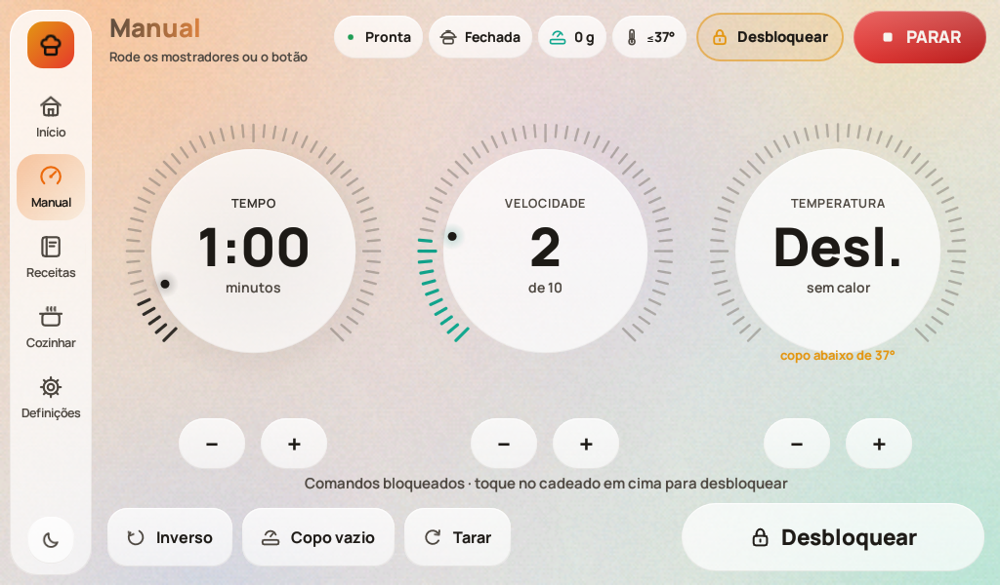
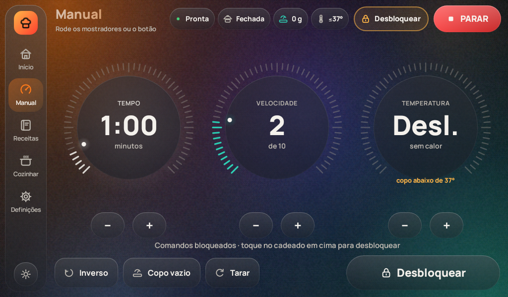
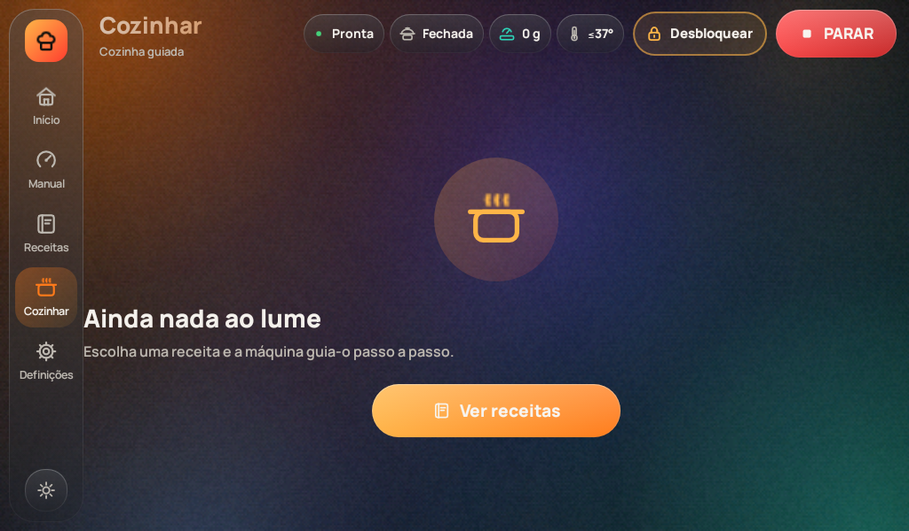
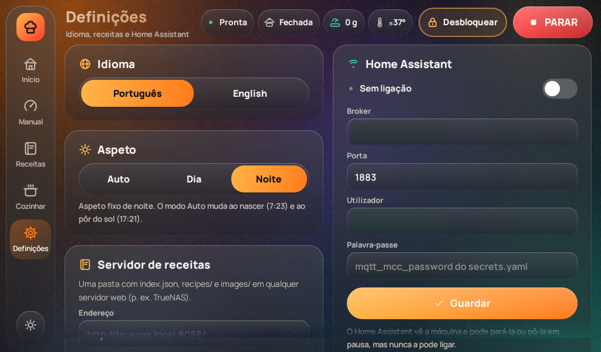

# mcc-app

An open replacement app for the **Silvercrest Monsieur Cuisine Connect** (SKMC 1200) kitchen machine.
It runs on the machine's own tablet and talks to the motor, heater and scale directly, without the cloud and
without the stock cooking app.

| Day | Night |
|---|---|
|  |  |
|  |  |

> [!WARNING]
> This software switches a 1000 W heater and a blade motor. It has **hard safety limits** (below), but it is a
> hobby project: use it only while you are standing at the machine, and at your own risk. Installing it requires
> opening the machine's service cover and modifying its firmware, which may void your warranty.
> Not affiliated with, endorsed by or supported by Lidl, Silvercrest or Silpion. "Monsieur Cuisine" and
> "Silvercrest" are trademarks of their owners and are used here only to say which machine this works with.

## What it does

- **Manual cooking**: time, speed (1–10) and temperature (37–130 °C) on three big dials, reverse, scale and tare.
  Works with the touch screen or the machine's jog knob.
- **Guided recipes** from a recipe server you control (any static web server). Preparation steps, weighing with a
  live gauge, and machine steps that run only after you hold Start.
- **Automatic programs**: boiled eggs, rice, steamed vegetables, melting chocolate, smoothie, proofing dough,
  reheating, and a **cleaning** program. They are ordinary guided recipes, so the same limits apply.
- **AI recipe import** (optional): point it at any OpenAI-compatible server (OpenAI, or one on your own network)
  and turn a web page or pasted text into a guided recipe. Settings from other machines ("10 min/100°C/speed 1")
  are converted, and anything outside the machine limits is adjusted and listed. The AI only writes recipes.
- **Home Assistant** over MQTT: status, temperature, speed, weight, lid, finish time and a Stop button. Home
  Assistant can stop, pause or tare. With the opt-in remote start, it can start one run you prepared and permitted
  at the machine, and nothing else.
- **Phone app** ([docs/PHONE.md](docs/PHONE.md)): live status, Stop and Pause, notifications when the recipe needs
  you or is ready, a live progress notification, recipes that follow the machine's current step, "open on the
  machine", and a shopping list. Works on phones without Google services and adapts to foldables.
- **The RGB LED** shows the state (idle, running, heating, done, error), as in the stock app.
- **Day and night looks** (Auto follows sunrise and sunset), **English and European Portuguese**.
- Fast on the 2015-era tablet: 1–6 % CPU at idle, a fixed 100 ms machine loop.

## Safety model, in short

- Controls are **locked at every app start**. Unlocking needs a confirmation, and starting needs a **900 ms hold**.
- A red **STOP** is always on screen. The jog knob never starts anything; Home Assistant only with the opt-in remote start.
- The machine layer refuses unsafe requests whatever asks for them: speed > 3 with heat or in reverse,
  more than 130 °C, more than 99 min (15 min above speed 6), and heat without a known empty-bowl weight or with
  less than 200 g in the bowl.
- It **stops** when the lid opens, the power board reports an error, or no valid board frame arrives for 1.5 s.
- Only normal runs (work command `01`) are enabled by default. Turbo (hold to run, max 10 s) can be switched on in
  Settings after its supervised test; knead, roast and steam are implemented but refused until each has had one.
- The app hands the serial port back if the stock machine service is running: never two writers.

Details: [docs/ARCHITECTURE.md](docs/ARCHITECTURE.md#safety).

## Getting started

1. **Get ADB access to the machine** with the community hack:
   [EliasKotlyar/Monsieur-Cuisine-Connect-Hack](https://github.com/EliasKotlyar/Monsieur-Cuisine-Connect-Hack)
   ([English guide](https://github.com/EliasKotlyar/Monsieur-Cuisine-Connect-Hack/blob/master/install_en/readme.md)).
   Make the backups it tells you to make. **Only ever connect the right-hand "Android USB" port**; the left port
   belongs to the power board.
2. **Build and install** this app over ADB. No root needed: the app is signed with the public AOSP test key that
   the firmware trusts.
3. Optional: **serve recipes** and **connect Home Assistant**.

The full walk-through is in [docs/SETUP.md](docs/SETUP.md).

## Repository map

| Path | What's inside |
|---|---|
| [`machine/`](machine) | Pure Kotlin machine layer: serial frame encoder/decoder, temperature table, `MachineController` with every safety limit. Tests replay real captures. |
| [`recipe/`](recipe) | Pure Kotlin recipe layer: the `mcc-recipe/1` model, expansion of machine steps, and the step-by-step `RecipeRunner`. |
| [`link/`](link) | Pure Kotlin MQTT contract (state, events, commands) shared by the machine app and the phone app. |
| [`common/`](common) | Android library shared by both apps: design tokens, icons, widgets, translations, recipe store, fonts and program photos. |
| [`app/`](app) | The machine (tablet) app: serial service, UI, LED, jog knob, MQTT bridge. |
| [`phone/`](phone) | The phone companion app (Compose, Material 3): status, notifications, recipes, shopping list. |
| [`recipe-repo/`](recipe-repo) | Recipe format spec, converters (recipe websites, stock-app JSON), index builder and sample recipes. Serve this folder (or your own copy) to the machine. |
| [`signing/`](signing) | The public AOSP platform test key (why: [signing/README.txt](signing/README.txt)). |
| [`docs/`](docs) | Setup, architecture, protocol, Home Assistant, test plan. |

## Documentation

- [docs/SETUP.md](docs/SETUP.md): from a stock machine to this app running, step by step
- [docs/ARCHITECTURE.md](docs/ARCHITECTURE.md): how the code fits together, safety, LED, knob, UI and performance rules
- [docs/PROTOCOL.md](docs/PROTOCOL.md): the tablet ↔ power-board serial protocol
- [docs/HOME-ASSISTANT.md](docs/HOME-ASSISTANT.md): MQTT topics, payloads, events and commands
- [docs/PHONE.md](docs/PHONE.md): the phone companion app
- [docs/TEST-PLAN.md](docs/TEST-PLAN.md): the supervised live tests
- [recipe-repo/README.md](recipe-repo/README.md) and [recipe-repo/FORMAT.md](recipe-repo/FORMAT.md): recipes

## Status

| Area | State |
|---|---|
| Serial protocol, lid, scale, tare, motor at speed 1 and 3, heat to 50 °C | verified live while the stock app drove the machine (captures in `machine/src/test/resources/captures`) |
| This app driving the motor or heater | **not yet tested live**: follow [docs/TEST-PLAN.md](docs/TEST-PLAN.md) |
| Turbo, knead, roast, steam | implemented, disabled until tested |
| UI, recipes, MQTT, LED, knob | working on the device |

Tested on power-board firmware 4921 and stock app v292 (Android 6, MT6580).

## Licence

[MIT](LICENSE). Third-party parts: [THIRD-PARTY.md](THIRD-PARTY.md). Contributions: [CONTRIBUTING.md](CONTRIBUTING.md).
